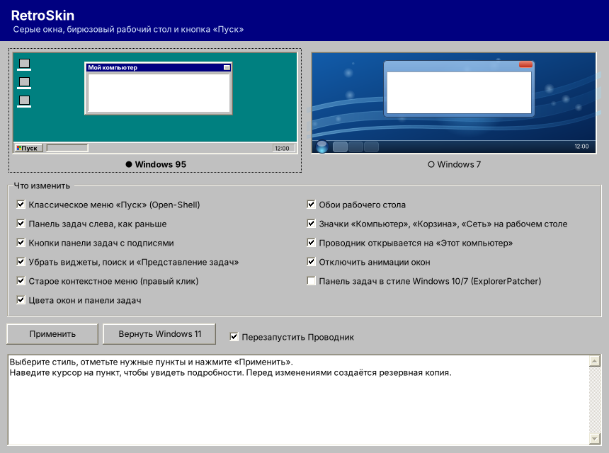
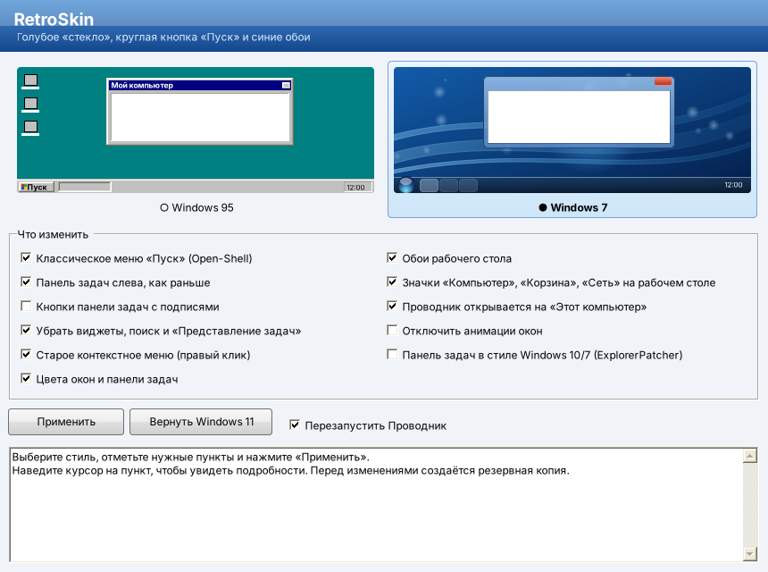

# 🖥️ RetroSkin

Программа для Windows 11 (и 10), которая делает интерфейс похожим на **Windows 95** или **Windows 7**. Всё меняется в один клик и так же возвращается обратно.

| Windows 95 | Windows 7 |
|---|---|
|  |  |

## Как пользоваться

1. Скачай `RetroSkin.exe` из папки [`dist/`](dist/) или из раздела **Releases** (сборки `retroskin-…`).
2. Запусти. Установка не нужна: программа работает на .NET Framework 4.8, который уже есть в Windows 10/11.
   Если появится «Windows защитила ваш компьютер», нажми «Подробнее» → «Выполнить в любом случае»: у файла нет платной цифровой подписи.
3. Выбери стиль, отметь пункты (наведи курсор на пункт, чтобы прочитать подробности) и нажми **«Применить»**.
4. Чтобы всё вернуть, нажми **«Вернуть Windows 11»**.

## Что меняется

| Пункт | Windows 95 | Windows 7 |
|---|---|---|
| Меню «Пуск» (ставится [Open-Shell](https://github.com/Open-Shell/Open-Shell-Menu) через winget) | классическое меню в один столбец, кнопка «Пуск» | меню в два столбца с поиском, круглая кнопка |
| Панель задач | слева, кнопки с подписями | слева, значки группируются |
| Виджеты, поиск, «Представление задач» | скрыты | скрыты |
| Контекстное меню | старое полное меню | старое полное меню |
| Цвета | тёмно-синие заголовки, серые неактивные окна, без прозрачности | голубые заголовки, тёмная полупрозрачная панель задач |
| Обои | бирюзовый фон | синий фон со световыми лентами (рисуется программой) |
| Значки на рабочем столе | Компьютер, Корзина, Сеть | + папка пользователя |
| Проводник | открывается на «Этот компьютер» | открывается на «Этот компьютер» |
| Анимации окон | выключены | как есть |
| Панель задач Windows 10/7 ([ExplorerPatcher](https://github.com/valinet/ExplorerPatcher)) | по желанию | по желанию |

Права администратора не нужны: все настройки пишутся в раздел текущего пользователя (`HKCU`). Запрос прав может появиться только при установке Open-Shell или ExplorerPatcher.

## Как работает откат

Перед первым изменением RetroSkin сохраняет исходные значения реестра в `%LOCALAPPDATA%\RetroSkin\backup.txt`. Повторное применение (например, сначала 95, потом 7) не затирает эту копию, поэтому «Вернуть Windows 11» всегда возвращает состояние до первого запуска. Open-Shell и ExplorerPatcher при откате не удаляются, их можно удалить в «Параметры → Приложения».

## Чего программа не умеет

Windows 11 не даёт штатно убрать скруглённые углы окон, вернуть ленту в Проводник и рамки окон старого образца. Для этого есть [Windhawk](https://windhawk.net) с модами от сообщества (поиск по словам «rounded corners», «classic theme»). Ставь их на своё усмотрение: они глубже вмешиваются в систему.

## Сборка

```bash
dotnet build RetroSkin/RetroSkin.csproj -c Release
# RetroSkin/bin/Release/net48/RetroSkin.exe
```

Нужен .NET SDK 8; собирается на Windows, Linux и macOS. При каждом push в `RetroSkin/` GitHub Actions (`.github/workflows/build-retroskin.yml`) собирает exe и выкладывает его в Releases.

```
RetroSkin/src/
├── Program.cs         — точка входа
├── MainForm.cs        — окно: выбор стиля, список пунктов, журнал
├── Controls.cs        — кнопки, карточки тем и заголовок в стиле 95/7
├── Tweaks.cs          — все изменения системы, применение и откат
├── RegistryBackup.cs  — резервная копия реестра
├── Artwork.cs         — обои и превью тем
└── Native.cs          — вызовы WinAPI (обои, анимации, рассылка изменений)
```
